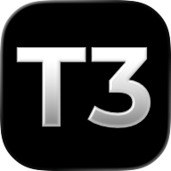

<<<<<<< HEAD
# Infinitus

Infinitus is one product on three screens: the macOS menu bar app that runs your Claude Code accounts (usage windows, swapping, the sessions on the Mac), the desktop and web app that drive the agents, and the phone app. This repository's `main` holds the desktop, web and phone apps and their server; the menu bar app lives in [`apps/mac`](apps/mac/README.md), and one `v<version>` tag releases all of them together (#823). Site: [infinitus.run](https://infinitus.run).

What the desktop, web and phone apps add to the agent client:

- **Accounts page** — every engine's fleet with per-account usage bars, the switch / hold / star / rename actions, the forecast of the next reset, and lapsed AWS and gcloud sign-ins with their device codes.
- **Settings › Menu bar, Notifications, Devices, Engines, Lock** — the menu bar app's preferences, notification routes, paired devices, engines and lock, edited from the browser.
- **Sidebar** — an Accounts pill with the active account and its fullest window.
- **Command palette** — "Open accounts".
- **Event toasts** — the engine's events (a swap, a reset, every account exhausted) surface as toasts in the app shell.
- **Phone** — Accounts per paired Mac, and the Mac's account alerts as banners.
- **Desktop** — the `run.infinitus.desktop` app, state under `~/.infinitus`, the menu bar app nested as a login item, and in-app updates from the GitHub releases.

Install: `Infinitus-<version>-arm64.dmg` from the [latest release](https://github.com/deathemperor/infinitus/releases/latest) is the desktop app with the menu bar app nested inside as a login item — one download. The menu bar app alone: `brew install --cask deathemperor/tap/infinitus` (or `Infinitus-<version>.zip` from the same release); Linux gets `infinitus-tray-linux-x86_64` / `-aarch64` and `infinitus-omarchy.tar.gz` beside them. The engine is [swapd](https://github.com/deathemperor/swapd).

How the apps talk to the menu bar app: only through its control socket (`INFINITUS_CONTROL_SOCKET` overrides the per-platform default), one JSON line each way; the engine's own files are never read.

For contributors: this tree builds on [T3 Code](https://github.com/pingdotgg/t3code), the upstream project. Upstream's `main` is merged in daily by the [Upstream sync](.github/workflows/upstream-sync.yml) workflow as a pull request; the rules, registration points and the list of Infinitus-only files are in [INFINITUS.md](INFINITUS.md). Everything below the rule is upstream's README, untouched except the Installation section, which describes this product's releases (#1192).

---
=======
<p align="center">
  <a href="https://t3.codes">
    
  </a>
</p>
>>>>>>> upstream-sync-8a45c51d8b-upstream-renamed

<h1 align="center">T3 Code</h1>

<<<<<<< HEAD
Works with your subscriptions on Claude Code, Codex, Cursor, Grok Build, OpenCode, Oh My Pi, Google Antigravity, Pi, and fx. If they're set up on your computer, T3 Code can control them.
=======
<p align="center">The open-source control plane for coding agents.</p>
>>>>>>> upstream-sync-8a45c51d8b-upstream-renamed

<p align="center">
  <a href="https://t3.codes/download"><strong>Download</strong></a> ·
  <a href="https://apps.apple.com/us/app/t3-code-remote-claude-more/id6787819824">iOS</a> ·
  <a href="https://play.google.com/store/apps/details?id=com.t3tools.t3code">Android</a> ·
  <a href="https://app.t3.codes">Web</a> ·
  <a href="./docs/README.md">Docs</a> ·
  <a href="https://discord.gg/jn4EGJjrvv">Discord</a>
</p>

<p align="center">
  <a href="https://t3.codes">
    
  </a>
</p>

T3 Code runs the coding agents on your machine and gives them one fast interface. Start a thread at your desk, then approve the next step from your phone.

It works with Claude Code, Codex, Cursor, OpenCode, Grok Build, Antigravity, Kiro, Pi, Muse Code, fx, and any [ACP](./docs/user/providers-acp.md) agent. If an agent is set up on your computer, T3 Code can control it.

<<<<<<< HEAD
Every Infinitus build comes from one [GitHub release](https://github.com/deathemperor/infinitus/releases) of this repository. There is no npm package, Homebrew cask, winget or AUR package for the desktop app; `npx t3` installs upstream's T3 Code, not Infinitus.

> [!WARNING]
> Infinitus drives Codex, Claude, Cursor, Grok Build, OpenCode, Oh My Pi, Antigravity, Pi and fx. Install and sign in to at least one before starting a thread:
>
> - Codex: install [Codex CLI](https://developers.openai.com/codex/cli) and run `codex login`
> - Claude: install [Claude Code](https://claude.com/product/claude-code) and run `claude auth login`
> - Cursor: install [Cursor CLI](https://cursor.com/cli) and run `agent login`
> - Grok Build: install [Grok Build CLI](https://x.ai/cli) and run `grok login`
> - OpenCode: install [OpenCode](https://opencode.ai) and run `opencode auth login`
> - Oh My Pi: install [Oh My Pi](https://github.com/oh-my-pi/oh-my-pi) and run `omp` once to sign in
> - Antigravity: enable it in Settings, then use **Install Antigravity** and **Sign in with Google**. No CLI is required.
> - Pi: install [Pi](https://www.npmjs.com/package/@earendil-works/pi-coding-agent) and run `pi` once to sign in to a model provider
> - fx: install [fx](https://fx.sh) and run `fx login` on the machine running the Infinitus server ([setup guide](./docs/user/providers-fx.md))
=======
## What you get

- **Your subscriptions.** T3 Code does not resell tokens. It drives the agents you are already signed in to.
- **Every agent in one place.** Change models in the middle of a thread. Let Claude hand a task to Codex.
- **Desktop, web, and phone.** One server, and every client shows the same threads. There are apps for iOS and Android.
- **Remote ready.** Run agents on any machine. Connect over your local network, Tailscale, or [T3 Connect](./docs/user/remote-access.md).
- **Git built in.** Each thread can work in its own worktree. Review the diff, then commit, push, and open a pull request with one button.
- **Fast.** Performance is a feature here. We measure it, and we treat a dropped frame as a bug.
- **Open.** MIT licensed. If you don't like something, fork it.

## Install

### Desktop app

[Download T3 Code](https://t3.codes/download) for macOS, Windows, or Linux. You can also use a package manager:

| Platform       | Command                                                              |
| -------------- | -------------------------------------------------------------------- |
| macOS          | `brew install --cask t3-code`                                        |
| Windows        | `winget install T3Tools.T3Code` or `scoop install extras/t3code`     |
| Arch Linux     | `yay -S t3code-bin`                                                  |
| Nix            | `nix profile add github:NixOS/nixpkgs/nixos-unstable#t3code`         |
| Debian, Ubuntu | `.deb` from [Releases](https://github.com/pingdotgg/t3code/releases) |
>>>>>>> upstream-sync-8a45c51d8b-upstream-renamed

### Desktop app (macOS, Apple Silicon)

<<<<<<< HEAD
`Infinitus-<version>-arm64.dmg` from the [latest release](https://github.com/deathemperor/infinitus/releases/latest). It bundles the server and the menu bar app (nested as a login item), updates itself from the releases, and can host your phone, a browser or another desktop. The menu bar app on its own: `brew install --cask deathemperor/tap/infinitus`, or `Infinitus-<version>.zip` from the same release.
=======
This installs the `t3` command. Run `t3` to start the server and open the web app.

```bash
curl -fsSL https://t3.codes/install.sh | sh
```
>>>>>>> upstream-sync-8a45c51d8b-upstream-renamed

### Headless server (Linux)

`curl -fsSL https://infinitus.run/install.sh | sh` installs the newest release's `t3-<version>-linux-<arch>.tar.gz` — the server as one self-contained executable, no Node.js needed — verified against its `SHA256SUMS` (releases cut after 0.5.0-alpha.11 attach them). The desktop app installs the matching one onto a Linux SSH remote by itself. To run one by hand, see [Install](./docs/user/install.md#headless-server-linux) and [Running in the background](./docs/user/background-service.md).

<<<<<<< HEAD
### Not available yet

- A macOS server archive. A Mac either runs the desktop app or a [build from source](./docs/user/install.md#build-from-source); for the same reason a Mac cannot yet be set up as an SSH remote from the desktop.
- Windows server archives.

#### Nix (nixpkgs)

```bash
nix profile add github:NixOS/nixpkgs/nixos-unstable#t3code
```

The package is maintained in [nixpkgs](https://github.com/NixOS/nixpkgs/tree/nixos-unstable/pkgs/by-name/t3/t3code)
and includes the desktop app (`t3code-desktop`) and the `t3` command.
See [Nix installation](./docs/user/install.md#nix-nixpkgs) for NixOS configuration and updates.

## Some notes

We are very very early in this project. Expect bugs.

We are (mostly) not accepting contributions yet. Small fixes may be considered. Big features will not be.
=======
To try it once without an install, run `npx t3@latest`.

### Phone

Get the app from the [App Store](https://apps.apple.com/us/app/t3-code-remote-claude-more/id6787819824) or [Google Play](https://play.google.com/store/apps/details?id=com.t3tools.t3code). Then follow [remote access](./docs/user/remote-access.md) to connect it to your computer.

### Sign in to an agent

T3 Code needs one agent that is installed and signed in. For example, install [Claude Code](https://claude.com/product/claude-code) and run `claude auth login`, or install [Codex CLI](https://developers.openai.com/codex/cli) and run `codex login`.

[Provider setup](./docs/user/install.md#providers) has the steps for each agent. [Install T3 Code](./docs/user/install.md) covers nightly builds, AppImage, WSL, and NixOS.

## "Wait, what are you selling me?"

Nothing. We built T3 Code because we wanted the best possible development experience with agents. We were inspired by existing solutions like the Codex desktop app, Conductor, Claude Desktop and Cursor Glass, but none met our bar.

We wanted something performant, remote-ready, and truly open. If we ever go the wrong direction, we want you to have everything you need to fork and build the tool that you want.
>>>>>>> upstream-sync-8a45c51d8b-upstream-renamed

## Documentation

- [Install and first run](./docs/user/install.md)
- [Remote access from a phone or another machine](./docs/user/remote-access.md)
<<<<<<< HEAD
- [Connect Claude Code, Codex, ChatGPT and other agents over MCP](./docs/user/outside-agents.md)
- [Keeping app and server in sync](./docs/user/updating.md)
- [Source control integrations](./docs/user/source-control.md)
- Multiple accounts: [Codex](./docs/user/providers-codex.md) · [Claude](./docs/user/providers-claude.md)
- [Run the server in the background](./docs/user/background-service.md)
=======
- [Permission modes](./docs/user/permission-modes.md)
- [Source control](./docs/user/source-control.md)
- [Connect outside agents over MCP](./docs/user/outside-agents.md)
- [FAQ](./docs/user/faq.md)
>>>>>>> upstream-sync-8a45c51d8b-upstream-renamed

[All docs](./docs/README.md) has the full list.

## Contributing

We have limited review capacity. Small, focused fixes are the most likely to be merged. Features need an approved discussion first.

- Read [CONTRIBUTING.md](./CONTRIBUTING.md) before you report a bug or open a pull request.
- Put feature requests in [Ideas](https://github.com/pingdotgg/t3code/discussions/categories/ideas).
- Build from source with the [development runbook](./docs/operations/development.md#first-checkout). The [architecture overview](./docs/internals/overview.md) explains how it works.
- Get help in [Discord](https://discord.gg/jn4EGJjrvv).

## License

[MIT](./LICENSE)
